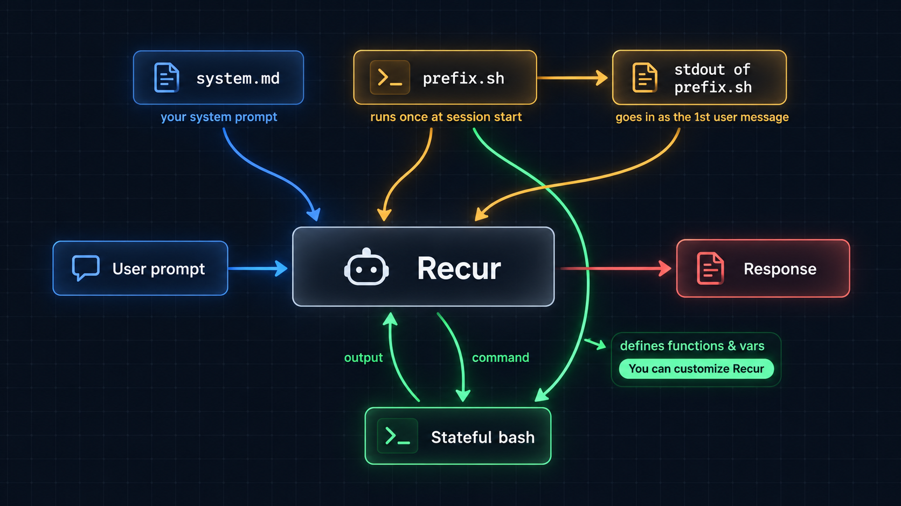

# Recur — an AI coding agent you can control 100%

Modern AI agents are hard to understand. What they do can feel like magic. Their system prompts are hidden, and changing their behavior can be unpredictable.

Recur solves this by keeping the agent simple and visible. You control 100%: the system prompt, the tools, and what enters the agent's context. All customization happens in these files:

- `system.md` — the system prompt, in plain Markdown
- `prefix.sh` — Bash code that runs at the start of a session; the code and its output enter the agent's context immediately
- `settings.toml` — provider, model, UI, and compaction settings
- `hooks.toml` (optional) — shell commands that run on events such as turn start, turn end or exit; see `recur docs hooks`

That's all you need to make an AI agent that solves your tasks. Each file can also live in a project's `.recur/` folder, and `--system`, `--prefix` and `--hooks` point to a specific file; project and `--hooks` hooks add to the global ones instead of replacing them. The start screen shows which files were read.



This isn't a heavy agent like Claude Code or OMP that decides everything for you. It isn't Pi or OpenCode, where you can get lost in your own plugins.

Recur is an AI agent you can make 100% your own, while keeping it simple and understandable. One Bash tool and fewer than 6,000 lines of source code.

## Installation

Currently supported: Linux and macOS on amd64 and arm64.

```sh
curl -fsSL https://raw.githubusercontent.com/ethanhamilthon/recur/main/scripts/install.sh | sh
```

## Development

Run from source with an isolated development home:

```sh
make dev
```

Rules for AI agents working on this repository are in [AGENTS.md](AGENTS.md).

## License

MIT

## Security

Recur runs in full YOLO mode. If you don't trust your models, use Docker or run Recur in a secure sandbox.
